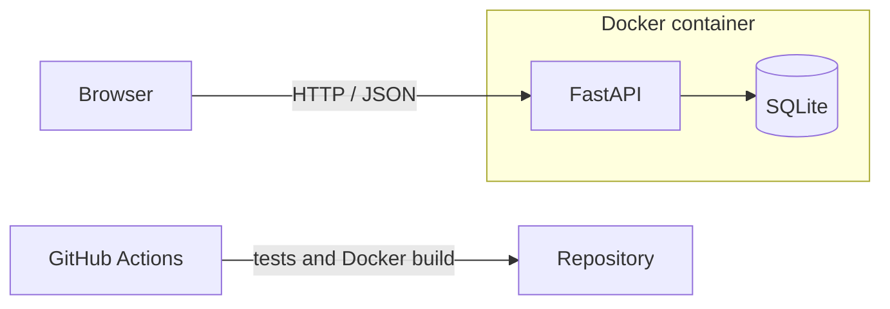

# Suivi de candidatures


A small web app to track job applications: add, edit, filter and count them by status.
Built end to end to practice a full development workflow: API, database, tests, containers and CI.

## Features

- Create, read, update and delete applications (company, role, link, status, date, notes)
- Filter by status and search by company or role
- Live counters for each status
- Server-side validation (invalid statuses and unsafe links are rejected)
- Demo mode that loads fictional data

## Tech stack

Python 3.14, FastAPI, SQLite, vanilla JavaScript, pytest, Docker, GitHub Actions.

## Architecture



## Run locally

```bash
python3 -m venv .venv
source .venv/bin/activate
pip install -r requirements.txt
uvicorn app.main:app --reload
```

Then open http://127.0.0.1:8000. Interactive API docs are at `/docs`.

## Run with Docker

```bash
docker compose up --build -d
DEMO_MODE=1 docker compose up -d   # optional: load fictional demo data
```

The database lives in a Docker volume, so data survives restarts.

## Tests

```bash
pytest
```

## API

| Method | Route | Description |
|--------|-------|-------------|
| GET | `/api/candidatures` | List applications (optional `?statut=`) |
| GET | `/api/candidatures/{id}` | Get one application |
| POST | `/api/candidatures` | Create an application |
| PUT | `/api/candidatures/{id}` | Update an application |
| DELETE | `/api/candidatures/{id}` | Delete an application |
| GET | `/api/stats` | Counts by status |
| GET | `/sante` | Health check |

## Notes

All queries are parameterised (no SQL injection), user text is rendered with `textContent`
(no XSS), and the container runs as a non-root user.
